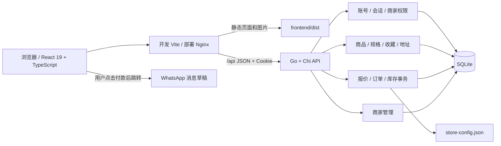

# 前后端分离架构

## 前端边界

`src/pages` 是路由页面；`src/components` 是复用 UI；`src/lib/api.ts` 统一 HTTP 和错误处理；`src/lib/types.ts` 定义数据契约；`src/lib/store.tsx` 维护用户、商品、收藏和购物车。表单与模态框由 React 管理，动态内容默认由 React 转义，没有依赖 `innerHTML` 或旧版事件委托。

保留 HashRouter 是为了兼容现有分享链接和静态部署。Vite 与 Go 是两个独立进程，开发代理只负责转发 API，不承载业务逻辑。

## 后端边界

`cmd/server` 只负责配置、启动和优雅退出；`internal/shop` 内按账号、商品、订单、后台拆分业务。路由统一处理 JSON、Origin 检查、会话和事务边界。SQL 使用参数绑定，数据库结构通过 `go:embed` 随二进制交付。API 不提供静态站点服务。

金额采用整数美分。订单创建时服务端验证规格归属、库存、数量、优惠券资格，再在一个事务中扣库存并保存快照。SQLite 采用 WAL、忙等待和 immediate 事务；当前为单实例部署，并发写入串行化，优先保证订单与库存一致性。

## 付款边界

WhatsApp 只用于建立联系，不是支付网关。后端读取配置并生成包含订单摘要的 URL。客户跳转不改变状态；管理员核实收款后确认。退款接口记录状态和恢复库存，不发起资金转账。

## 数据迁移

保留现有 SQLite 数据和原账号会话，不转换历史订单金额。密码兼容原有 PBKDF2，并在成功登录时迁移至 bcrypt。空库才初始化商品。`legacy` 仅保存旧版本，不参与服务启动。

## COA 报告图片

`frontend/public/reports/` 存放自托管的 97 份检测报告（1588×2245 JPEG），`catalog.json` 与 `coaExtra.json` 的 `reportUrl` 指向这里，不再外链第三方图床。报告原始文件由同一模板生成，其中 Manufacturer / Official Website 与 Sample / Batch 两行的框位置、灰度和字号与上方字段不一致，`scripts/mirror_report_images.py` 在镜像时按 “Task Number / Received Date” 这一行重建这两行，并保留每份报告自己的样品名与批号。`scripts/fix_test_report_fields.py` 用同样方式重建本地样例图 `tideora-test-report-sample.jpg`（无报告时兜底）。源地址记录在 `scripts/report_image_sources.json`。
